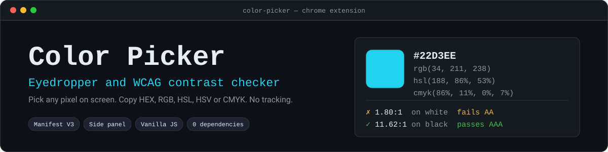

<div align="center">



<br>


</div>

A Chrome extension that picks any color from your screen and hands it back in the format you need. It opens in the **side panel**, so it stays put while you click around a page and sample as many colors as you like.

## Features

- **Eyedropper**: sample any pixel on screen with the browser's built-in `EyeDropper` API. Press `Esc` to cancel.
- **Five formats**: HEX, RGB, HSL, HSV and CMYK, each one click to copy. The format you used last is remembered.
- **Copy on pick**: optionally copies the color to the clipboard the moment you pick it.
- **WCAG contrast**: contrast ratio against white and black text, with AA, AAA and AA-large results.
- **Type or choose a color**: paste `#22D3EE`, `rgb(34 211 238)`, `hsl(188 86% 53%)` or a CSS name like `rebeccapurple`, or use the palette.
- **Nearest CSS color name** for whatever you picked.
- **History** of your last 24 colors, saved between sessions.
- **Private**: no network access, no analytics, no accounts.

## Install

The extension is not on the Chrome Web Store yet, so load it unpacked:

1. Clone or download this repository.
2. Open `chrome://extensions` and turn on **Developer mode** (top right).
3. Click **Load unpacked** and choose this folder.
4. Pin the extension, then click its icon to open the side panel.

Requires **Chrome 114 or newer** (side panel API; the eyedropper needs Chrome 95+). Other Chromium browsers that support both APIs may work, but only Chrome is targeted.

## Using it

| Action | How |
|---|---|
| Pick from the screen | **Pick from screen**, or press `P` when no text field is focused |
| Cancel a pick | `Esc` |
| Copy a format | Click its row under **Copy as** |
| Enter a color by hand | Type in the value box and press `Enter` |
| Reuse an earlier color | Click a swatch under **History** |
| Stop auto-copy | Untick **Copy to clipboard right after picking** |

## Contrast ratios

Ratios follow the [WCAG 2 definition](https://www.w3.org/TR/WCAG21/#dfn-contrast-ratio). The displayed ratio is **truncated, not rounded**, so a color at 4.498:1 shows `4.49:1` and correctly fails AA instead of being rounded up to a pass.

| Level | Normal text | Large text |
|---|---|---|
| AA | 4.5 : 1 | 3 : 1 |
| AAA | 7 : 1 | 4.5 : 1 |

## Permissions

| Permission | Why |
|---|---|
| `sidePanel` | Shows the picker in the browser side panel |
| `storage` | Saves your history and preferences locally with `chrome.storage.local` |
| `clipboardWrite` | Copies a color when you click a format or pick with auto-copy on |

There are no host permissions, so the extension cannot read or modify any web page. It makes no network requests.

## Development

No build step and no dependencies. Requires Node 20 or newer for the tests.

```bash
npm test                  # unit tests for the color library + manifest validation
node --test               # unit tests only
node scripts/validate.mjs # manifest, icon sizes and Manifest V3 CSP rules
```

`lib/color.js` is a pure module (no DOM, no extension APIs), so the same code runs in the panel and under Node tests. The tests cover parsing of every supported syntax, round-trip conversions, WCAG reference values (for example `#777777` on white is 4.48:1 and must fail AA), and nearest-name lookup.

| File | Role |
|---|---|
| `manifest.json` | Manifest V3 definition |
| `background.js` | Opens the side panel when the toolbar icon is clicked |
| `panel.html` / `panel.css` / `panel.js` | The side panel UI |
| `lib/color.js` | Parsing, conversion, formatting, contrast and CSS color names |
| `test/color.test.js` | Unit tests for the color library |
| `test/background.test.js` | Runs the real service worker in a sandbox with a stubbed `chrome` API |
| `scripts/validate.mjs` | Package checks run in CI |

## License

Released under the [MIT License](LICENSE).
